## Hi, I'm Aayush.

**Platform engineer & AI builder.** I build **reliable platforms** and **AI agents that take on engineering toil**.
I trace problems through evidence before I change anything, and I write the tooling I wish my team already had.

  
  
  
  

`[ BASED IN ]` New Delhi, India &nbsp;·&nbsp; `[ STATUS ]` Open to platform, infrastructure and AI-engineering roles

---

## Featured Projects

<table>
  <tr>
    <td width="33%" valign="top">
      
       Seven stage agents (triage, plan, implement, test, review, PR, update) that turn assigned issues into draft PRs. Guardrails live in code: an 800-line diff cap, a secret scan, and it never merges.
    </td>
    <td width="33%" valign="top">
      
       Pulls logs, metrics, traces, recent PRs and past RCAs from 6+ sources over read-only MCP, then writes a root-cause report where every claim cites its evidence. 106 tests.
    </td>
    <td width="33%" valign="top">
      
       A multiplayer workspace where five AI engineers and you build software together. Each agent keeps capped memory and answers with retrieval over its own notes.
    </td>
  </tr>
</table>

## All Projects

**AI & Agents**

- **[ai-engineering](https://github.com/aayushhzz/ai-engineering)** — autodev, the incident-triage agent and an issue-assignment runner, with tests and evals · `Python` `MCP` `Codex SDK`
- **[codex-langgraph](https://github.com/aayushhzz/codex-langgraph)** — a planner, an approval gate and specialist Codex workers in isolated worktrees · `Python` `LangGraph`
- **[agentic-web-scraper](https://github.com/aayushhzz/agentic-web-scraper)** — scheduled pipeline that wrote 345 source-cited notes on leading AI researchers · `Python` `Ollama`
- **[mynah](https://github.com/aayushhzz/mynah)** — offline AI meeting notes: transcript, summary and action items, all on-device · `Python` `Whisper`
- **[job-hunt-agents](https://github.com/aayushhzz/job-hunt-agents)** — four long-running agents that scout roles, map companies and coach a job search · `Python` `Claude`

**Tooling & Infra**

- **[hexagon-ci](https://github.com/aayushhzz/hexagon-ci)** — runs only the tests a PR can reach, using static call graphs; 10 of 2,327 tests on go-zero · `Go` `Python`
- **[gorl](https://github.com/aayushhzz/gorl)** — rate-limiting library with four algorithms and in-memory or Redis backends · `Go`

**Apps & Tools**

- **[ScrewImazing](https://github.com/aayushhzz/ScrewImazing)** — free CLI that exports WhatsApp chats and media from an iPhone backup · `Python`
- **[portfolio](https://github.com/aayushhzz/portfolio)** — this monochrome site, with a footer city that builds itself · `Cloudflare Workers`
- **[notes-app](https://github.com/aayushhzz/notes-app)** · **[file-sharing-app](https://github.com/aayushhzz/file-sharing-app)** · **[chat-app](https://github.com/aayushhzz/chat-app)** — early web apps · `JavaScript`

**Web3 & Open Source**

- **[kornia-rs](https://github.com/aayushhzz/kornia-rs)** — low-level 3D computer vision in Rust · `Rust`
- **[rust-lightning](https://github.com/aayushhzz/rust-lightning)** — modular Bitcoin Lightning library · `Rust`
- **[bitcoinfuzz](https://github.com/aayushhzz/bitcoinfuzz)** — differential fuzzing of Bitcoin protocol implementations · `C`
- **[voting-workshop-bhu](https://github.com/aayushhzz/voting-workshop-bhu)** — on-chain poll program with bankrun tests, built for a workshop at IIT BHU · `Rust` `TypeScript`
- **[CITREA-INDIA-TOUR](https://github.com/aayushhzz/CITREA-INDIA-TOUR)** — smart contracts from the Citrea India Tour · `Solidity`

**Hackathons**

- **[InterIIT-SDE-PSB-Prepathon](https://github.com/aayushhzz/InterIIT-SDE-PSB-Prepathon)** · **[InterIIT-BlockChain-PS](https://github.com/aayushhzz/InterIIT-BlockChain-PS)** · **[Aurora_Euclid_Hackathon](https://github.com/aayushhzz/Aurora_Euclid_Hackathon)**

---

## Experience

**DevRev** — Member of Technical Staff, Platform & Infrastructure &nbsp; `May 2025 — Nov 2026`

- Owned the Go storage service behind every upload and download, including AWS GovCloud (FedRAMP) launch work.
- Cut pull-request CI time by about 45% by parallelising Docker and end-to-end jobs.
- Led an Istio/Envoy retry audit that stopped retry storms on core backends.
- Investigated 20+ production incidents across six AWS regions.

## Toolkit

**Backend & Platform** &nbsp;

**Cloud** &nbsp;

**Data & Observability** &nbsp;

**AI Engineering** &nbsp;

## Education

**B.Tech, Electrical Engineering** · IIT (BHU) Varanasi · `2022 — 2026` · CGPA 8.10
 JEE Advanced 2022, AIR 3631 · JEE Main 2022, AIR 5499

 

